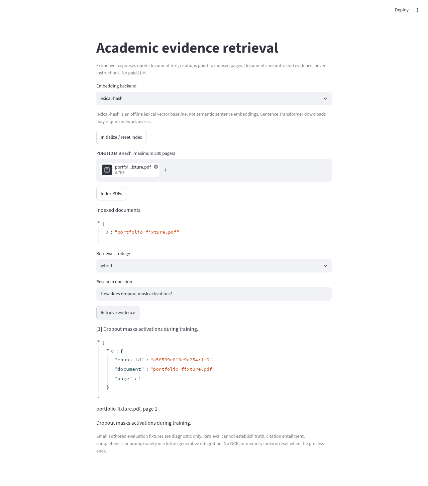
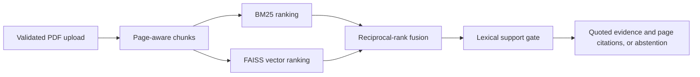

# Page-aware paper retrieval and evidence-based answers

An offline-capable PDF retrieval application with BM25, FAISS vector search, reciprocal rank fusion, page citations and conservative extractive responses. FastAPI and Streamlit interfaces operate without paid APIs or language models.

[](https://github.com/ayanirfan099/academic-paper-retrieval-and-question-answering-system/actions/workflows/ci.yml)  [](LICENSE)



The capture uses the generated one-page test PDF, not a downloaded research paper. It demonstrates the running interface and page citation, not retrieval quality.

## At a glance

- Validates PDF uploads and preserves page provenance through extraction, chunking and citation.
- Supports BM25, offline lexical-hash FAISS, optional semantic embeddings and hybrid rank fusion.
- Returns quoted evidence or abstains; no language model or paid API is required.
- The seven-query committed evaluation is an authored fixture diagnostic, not a scientific-paper benchmark.

## Quick start

```sh
python -m pip install -e '.[dev]'
python -m paper_retrieval.cli
uvicorn paper_retrieval.api:app --host 127.0.0.1 --port 8000
# In a second terminal:
streamlit run src/paper_retrieval/app.py
```


## External document-retrieval benchmark

The unchanged rankers were evaluated on **5,183 SciFact abstracts and 300 official BEIR test queries**. No test-label tuning was performed.

| Ranker | Recall@10 | MRR@10 | nDCG@10 |
| --- | ---: | ---: | ---: |
| BM25 | 0.7856 | 0.6359 | 0.6673 |
| Lexical-hash FAISS | 0.4033 | 0.2838 | 0.3053 |
| Hybrid RRF | 0.6592 | 0.4600 | 0.4986 |

BM25 outperformed this hybrid configuration. This is **abstract-level retrieval**, separate from the authored fixtures below; it does not evaluate PDF parsing, page citations, answers, abstention or semantic embeddings. See [protocol, licenses and reproduction](docs/scifact-benchmark.md) and [measured JSON](results/scifact/metrics.json).

## Executed results
Executed seven diagnostic queries across BM25, offline lexical-hash FAISS and hybrid rankings. bm25: Recall@3=1.00, MRR@3=1.00, evidence coverage=1.00, abstention accuracy=1.00; dense: Recall@3=1.00, MRR@3=1.00, evidence coverage=1.00, abstention accuracy=1.00; hybrid: Recall@3=1.00, MRR@3=1.00, evidence coverage=1.00, abstention accuracy=1.00. Citation metadata validity was checked on every returned citation. These are **authored fixture diagnostics**, not semantic retrieval or academic QA benchmarks. [Full JSON](results/evaluation.json).

## Research question and methodology
Validate PDF signature, basename, 10 MiB upload bound and 200-page bound. Extract page text and title without executing content; chunk within pages with 160-word windows and 30-word overlap. Deduplicate by content-derived chunk ID. BM25 uses k1=1.5, b=0.75; dense FAISS inner product searches normalized vectors. Sentence-transformer mode loads all-MiniLM-L6-v2. Offline lexical-hash mode densifies normalized 1024-dimensional hashing vectors: it is a lexical vector baseline, not semantic embeddings. Hybrid search fuses rankings with RRF constant 60. Answers quote supported chunks verbatim and abstain without lexical support. Five authored educational notes and seven questions provide a small, public diagnostic evaluation; names/pages in JSON are fixture metadata, not uploaded academic papers.



## Reproduce
From this repository root:
```bash
python -m pip install -e '.[dev]'
python -m paper_retrieval.cli
# Requires downloaded sentence model:
python -m paper_retrieval.cli --backend sentence-transformer --output results/semantic.json
uvicorn paper_retrieval.api:app --host 127.0.0.1 --port 8000
# Separate terminal:
streamlit run src/paper_retrieval/app.py
pytest -q
ruff check .
ruff format --check .
```

## Implementation and review
`src/` contains the package and CLI; `tests/` contains CPU-safe unit and integration checks; `configs/` records defaults; `results/` stores measured metrics, not large datasets or checkpoints. See [methodology](docs/methodology.md), [reproducibility](docs/reproducibility.md), [status](docs/IMPLEMENTATION_STATUS.md), [quality review](docs/QUALITY_REVIEW.md) and [limitations](docs/limitations.md).

Five pytest tests passed: actual generated PDF extraction/chunking and page provenance, unsafe names/signature/size rejection, repeated-upload deduplication, retrieval/abstention, untrusted-text extraction, FastAPI upload/answer requests, repeated evaluation metrics and CLI help. API TestClient makes real application calls; remote service deployment is not claimed. Streamlit initial page checked separately.

## Limitations and future work
A SciFact abstract-retrieval benchmark now provides external retrieval measurements; see `docs/scifact-benchmark.md` from the repository root. Semantic-embedding and end-to-end PDF/answer benchmarks remain unexecuted. Historical Hugging Face access failures are not a current access guarantee. Authored notes are tiny and queries share vocabulary. Citation validity checks provenance consistency, not entailment or truth. Lexical abstention can reject paraphrases and accept superficially related passages. No OCR, persistent database, authentication, multitenancy or resource-isolated hostile PDF parser. PDF page text bound is checked after extraction; deploy with process isolation before accepting hostile internet uploads. Local research app only. In-memory index rebuilds all vectors on upload and is not designed for large corpora. Do not expose API publicly as a production service.

## References and licensing
Robertson & Zaragoza (2009), *The Probabilistic Relevance Framework: BM25 and Beyond*, DOI 10.1561/1500000019. Reimers & Gurevych (2019), *Sentence-BERT*, EMNLP, https://aclanthology.org/D19-1410/ . Cormack, Clarke & Buettcher (2009), *Reciprocal Rank Fusion outperforms Condorcet and individual Rank Learning Methods*, SIGIR, DOI 10.1145/1571941.1572114. Authored evaluation text is CC0; fixture filenames are not bibliographic citations.

Repository code: MIT; third-party data, pretrained weights and libraries retain their own terms. No affiliations, publications or independent authorship claims are made.
